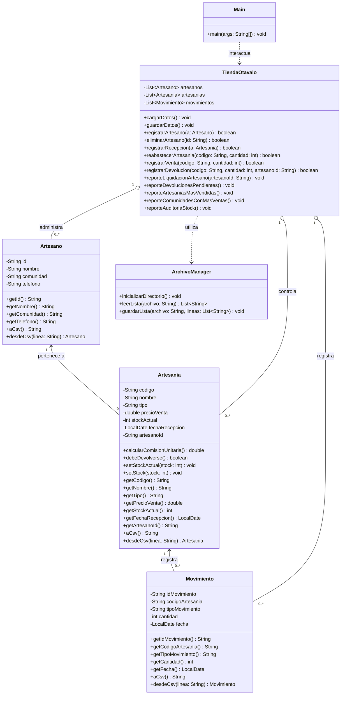

## Diagrama de Clases


# Sistema de Gestión para la Tienda de Artesanías de Otavalo

Sistema desarrollado en **Java** bajo una arquitectura modular orientada a objetos, diseñado para gestionar artesanos, inventario de artesanías en consignación (textiles y maderas), control de ventas, devoluciones por antigüedad (>90 días) y liquidaciones, con persistencia basada en archivos **CSV**.

---

## Características Principales
* **Gestión de Artesanos:** Registro y validación de datos de artesanos (cédula, nombre, comunidad, teléfono).
* **Control de Inventario y Consignación:** Registro de nuevas piezas, reabastecimiento de stock y control de plazos de devolución (90 días).
* **Reglas de Negocio Automatizadas:**
  * Comisión del **20%** para productos tipo `TEXTIL`.
  * Comisión del **25%** para productos tipo `MADERA`.
* **Procesamiento de Ventas y Auditoría:** Descuento automático de stock y registro cronológico de movimientos.
* **Reportes Gerenciales:** Liquidación de artesanos, alertas de devoluciones pendientes, piezas más vendidas, ventas por comunidad y auditoría de stock.
* **Persistencia en Archivos CSV:** Almacenamiento local estructurado (`artesanos.csv`, `artesanias.csv`, `movimientos.csv`).

---

## Estructura del Proyecto
El código fuente está organizado en los siguientes paquetes:
```text
src/
│
├── modelo/          # Clases de entidad (Artesano, Artesania, Movimiento)
├── negocio/         # Lógica del sistema y reglas de negocio (TiendaOtavalo)
├── datos/           # Manejador de persistencia de archivos CSV (ArchivoManager)
└── Main.java        # Menú interactivo en consola y punto de entrada

---
